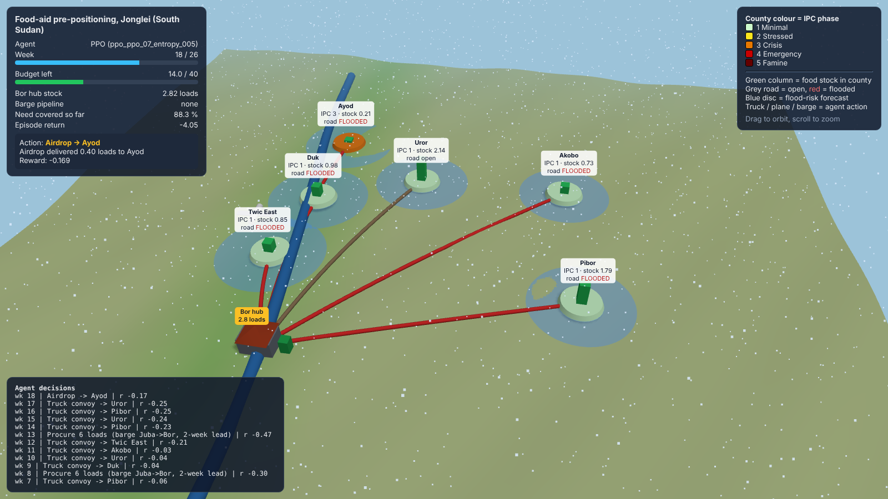

# Food-Aid Pre-positioning in Jonglei, South Sudan: DQN vs REINFORCE vs PPO vs A2C

**Student:** Ajak Bul Zachariah Chol · ALU · Machine Learning Techniques II, RL Summative

An RL agent plays the role of a humanitarian logistics coordinator at the Bor hub (Jonglei State).
Over a 26-week lean season it decides, each week, whether to **send a truck convoy**, **order an
airdrop**, **procure food by barge** (2-week lead time) or **hold**, for six counties (Twic East, Duk,
Ayod, Uror, Akobo, Pibor). Floods progressively cut roads, so food that is not pre-positioned early
can later be delivered only by expensive airdrops. The goal is to keep every county out of
Emergency/Famine (IPC 4–5) within a fixed budget.

All four algorithms are implemented with **TorchRL** and trained on the same environment with the
same 166,400-step budget per run (12 hyperparameter runs per algorithm, 48 in total).



## Quick start (uv only)

```bash
git clone <this repo> && cd ajak_chol_rl_summative
uv sync                      # creates .venv and installs pinned dependencies from uv.lock
uv run main.py               # best agent, live 3D viewer + verbose terminal log
```

Open **http://127.0.0.1:8765/** if the browser does not open by itself (on WSL, paste the URL into a
Windows browser). The simulation waits 4 seconds for the browser before it starts.

| Command | What it does |
|---|---|
| `uv run main.py --algo ppo` | Run the best model of one algorithm (`dqn`, `reinforce`, `ppo`, `a2c`, `best`) |
| `uv run main.py --hard` | Unseen harder season (floods 3 weeks earlier, more need, less budget) |
| `uv run main.py --no-render` | Terminal only |
| `uv run main.py --compare` | Evaluate the four best models on 100 unseen + 100 hard seeds |
| `uv run main.py --serve` | JSON policy API: `POST /api/policy {"observation": [41 floats]}` |
| `uv run play.py` | Same as `main.py` |
| `uv run python -m training.dqn_training --sweep` | Re-run the 12 DQN experiments |
| `uv run python -m training.pg_training --algo all --sweep` | Re-run the 36 REINFORCE/PPO/A2C experiments |
| `uv run python -m training.analyze` | Rebuild sweep tables (`logs/sweep_*.csv`), best-model index, figures |
| `uv run pytest -q` | Environment unit tests |

> Note: `torch` from PyPI on Linux/WSL pulls CUDA libraries (about 3–5 GB). Training and playback run
> on CPU, so no GPU is needed.

## Environment summary

| Element | Design |
|---|---|
| Actions (Discrete 14) | 0 hold · 1–6 truck convoy to county · 7–12 airdrop to county · 13 procure 6 loads |
| Observation (Box 41, [0,1]) | week, hub stock, budget, barge pipeline (2) + per county: stock, weeks of cover, hunger severity (IPC), road open, flood-risk forecast, weekly need |
| Reward | −unmet need (population-weighted) −0.5·severity −0.05·cost −0.5 failed convoy −0.3 invalid action; famine: −(10 + weeks left) and episode ends; end bonus +3·share of population at IPC ≤ 2 |
| Start | Random hub stock (3–6), county stocks (0–0.8), severity (IPC 1–2), flood onset per county (±3 weeks) |
| Terminal | Week 26 (truncation) or famine (IPC 5) in any county |

## Results (greedy policy, 100 unseen seeds)

| Agent | Best run | Mean return | Famine rate | 3-seed mean ± std | Harder unseen season |
|---|---|---|---|---|---|
| **PPO** | ppo_07_entropy_005 | −5.73 | 9% | **−5.47 ± 0.56** | **−19.23** |
| DQN | dqn_02_lr_low | **−5.50** | 13% | −7.19 ± 1.28 | −21.48 |
| A2C | a2c_07_entropy_005 | −9.25 | 23% | −9.80 ± 0.56 | −22.12 |
| REINFORCE | rf_10_entropy_005 | −12.64 | 36% | −12.84 ± 0.23 | −25.89 |
| Expert rule (baseline) | – | −7.86 | 18% | – | −20.30 |
| Random (baseline) | – | −29.66 | 100% | – | −31.56 |

PPO is the default agent in `main.py`. It has the best mean over three training seeds, the fastest
convergence (about 70k steps) and the best transfer to the harder season. Full tables: `logs/sweep_*.csv`.

## Repository layout

```
main.py / play.py          run best agent, 3D viewer, policy API
environment/custom_env.py  Gymnasium env, baseline policies
environment/rendering.py   three.js WebGL viewer server + matplotlib frames
environment/web/           viewer.html + vendored three.js (no CDN needed)
training/common.py         TorchRL env wrapper, networks, evaluation, model loading
training/dqn_training.py   DQN (DQNLoss, replay buffer, target network, ε-greedy)
training/pg_training.py    REINFORCE (ReinforceLoss), PPO (ClipPPOLoss + GAE), A2C (A2CLoss + GAE)
training/analyze.py        tables, best-model selection, figures
models/dqn, models/pg      48 trained models (.pt) + best_models.json
logs/                      per-run JSON learning curves, sweep CSVs, generalization.json
assets/                    figures used in the report
tests/                     pytest suite
```
